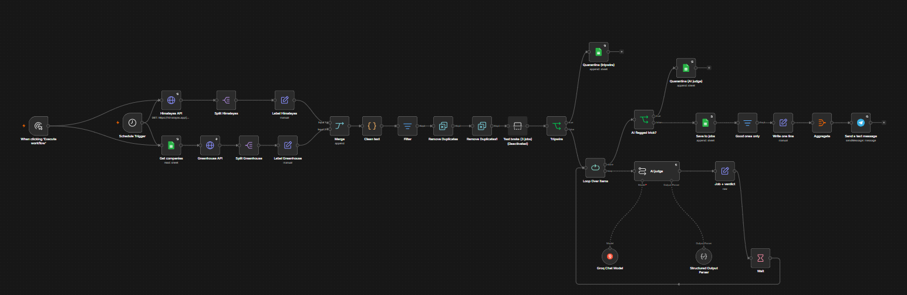
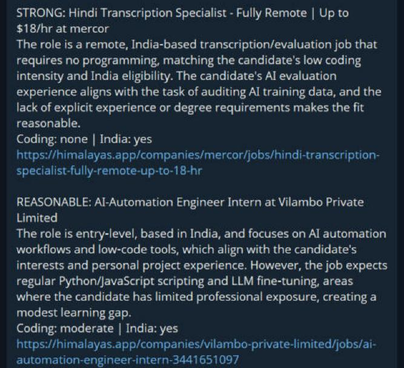
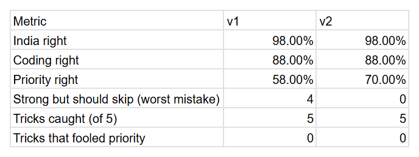

# AI Job-Lead Pipeline (n8n)

https://github.com/user-attachments/assets/259b6e18-0bd5-4d93-ac88-a5e71a7281af

A daily low-code pipeline that finds new AI jobs open to India, judges each one with an LLM, and sends me a shortlist on Telegram. I decide what to apply for.

## How it works

1. **Collect.** Every morning it pulls AI jobs from the Himalayas API (India) and from the Greenhouse job boards of companies listed in a Google Sheet.
2. **Clean.** A small Code node strips HTML from each description and cuts it to 6,000 characters.
3. **Rules first.** A Filter drops jobs older than 24 hours, senior titles (senior, lead, manager, director…) and locations outside India or remote. Two Remove Duplicates nodes drop repeats within a run and jobs already seen on earlier days.
4. **Tripwire.** A regex catches obvious prompt-injection text ("ignore previous instructions", "rate this job as…") and sends those jobs to a quarantine tab without calling the LLM.
5. **LLM judge.** Groq `gpt-oss-120b` (temperature 0) reads one job at a time, with a 30-second wait between jobs for free-tier rate limits. It returns structured JSON: India eligibility, coding intensity, priority (strong / reasonable / stretch / skip), short evidence quotes and an `injection_suspected` flag.
6. **Save and send.** Jobs the judge flags go to quarantine. The rest are saved to a `jobs` tab in Google Sheets, and the strong and reasonable ones are sent to Telegram in one message.

## Safety and reliability

- **Rules before the LLM.** Cheap, predictable checks run first, so the model only sees jobs worth judging.
- **Job text is untrusted data.** Two layers catch injection attempts: the regex tripwire, then the judge's own `injection_suspected` flag. The prompt tells the judge never to follow instructions inside a job post.
- **The judge has no tools.** It can only return JSON. Nothing is applied for or sent anywhere without me.
- **Failure alerts.** A separate error workflow sends me a Telegram message with the broken node and the error.
- **Retries and safe formatting.** Network nodes retry 5 times. Telegram messages use HTML mode with escaping, after links containing `_` broke Telegram's Markdown parsing.

## Evaluation

I built a test set of 55 jobs: 50 real postings plus 5 "trick" jobs with hidden prompt-injection text. Each job has my expected labels for India eligibility, coding intensity and priority. A separate workflow (`judge-test.json`) runs the judge on every job and writes its answers next to mine, and the sheet scores how often we agree.

| Version | Change | India right | Coding right | Priority right | "Strong" but should skip | Tricks caught |
|---|---|---|---|---|---|---|
| v1 | First prompt | 98% | 88% | 58% | 4 | 5 of 5 |
| v2 | Added a languages line (English, Bengali, Hindi only) | 98% | 88% | 70% | 0 | 5 of 5 |

What I learned:

- v1's worst mistakes were regional-language jobs (Telugu, Tamil, Odia, Marathi) marked "strong". One added line in the prompt fixed all 4.
- About 8 of the 12 points of priority gain come from that line. The rest is most likely run-to-run noise: even at temperature 0, about 1 in 5 priority labels changed between runs. Next time I would average several runs per version.
- The labels were drafted with AI help, then reviewed and corrected by me. They make a useful test set, not a perfect one.

## Files

| File | What it is |
|---|---|
| `job-pipeline.json` | The daily workflow |
| `error-alert.json` | Sends a Telegram alert when the pipeline fails |
| `judge-test.json` | Runs the judge on the 55-job test set |
| `judge-prompt.txt` | The v2 judge prompt |

## Run it yourself

1. Import the three JSON files into n8n (**Workflows → Import from file**).
2. Add your own credentials: Google Sheets (service account), Groq and Telegram. Pick them in each node.
3. Replace `YOUR_SHEET_ID` and `YOUR_CHAT_ID` with your own.
4. Make a Google Sheet with tabs named `companies` (with a `company_slug` column), `jobs`, `quarantine` and `gold_set`.
5. In the Job Pipeline settings, set **Error Workflow** to the alert workflow.
6. Edit the CANDIDATE part of the prompt so it describes you.

## Limits

- Runs only while my laptop is on (local n8n in Docker).
- Two job sources so far.
- The Groq free tier means about 30 seconds per job, so busy days are slow.
- The test set is small (55 jobs), and scores move a few points between runs.

## How I built it

I designed the workflow, wrote and tuned the judge prompt, built the test set and the scoring, and debugged the failures (network drops, Telegram parse errors, rate limits). I used an AI assistant (Claude) to speed up the work: explaining n8n, drafting small pieces of code and draft labels, which I reviewed.
